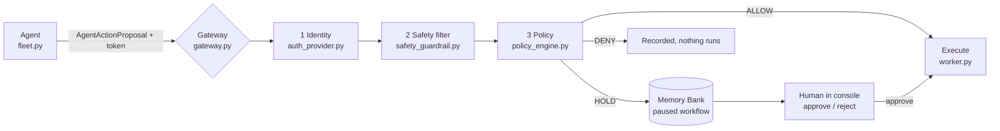
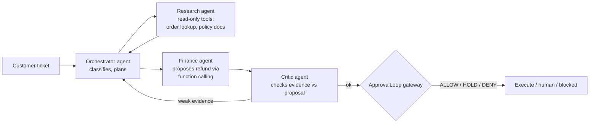

# ApprovalLoop study guide: reverse-engineering the project for an AI engineer role

This guide takes you through the ApprovalLoop codebase so you can explain every part of it in an interview, extend it, and turn it into a multi-agent project of your own.

You don't need to know everything before you start. Each station tells you what to read, what the idea is called in the industry, what to ask yourself, and one thing to try with your own hands.

**Time:** about four weeks at one to two hours a day (see [the plan](#10-four-week-plan)).

**File links** are relative to this file. `gateway.py:84` means line 51 of that file.

---

## 1. The project in three sentences

1. AI agents (finance, support, sales) want to take actions that cost money: refunds, account credits, discounts.
2. ApprovalLoop sits in the middle: the agent only **proposes** an action, and plain, predictable code decides whether it runs automatically, waits for a human, or is blocked.
3. Separately, a scheduled loop chases expense reports that are stuck waiting for an approver, using an LLM only to write the reminder wording.

The project's motto is **"AI proposes. Deterministic policy decides. Infrastructure executes."** If you remember one sentence, remember that one.

### What the project is, and what it is not

Interviewers will open the code. Know exactly what is real before you describe it.

| The README or a quick reading suggests | What the code actually does | Where to check |
|---|---|---|
| A multi-agent AI system | Three agents that never talk to each other. Each one independently sends a proposal to one gateway. There is no planner, no hand-off and no shared conversation. | [fleet.py](../backend/approval_loop/agent/fleet.py) |
| Gemini decides what to propose | The agent's **function arguments** set the action, amount, recipient and target. Gemini, if a key is set, only rewrites the `justification` text. With no key, no model is called. | [fleet.py:122-156](../backend/approval_loop/agent/fleet.py) |
| Structured output from Gemini | The prompt *asks* for JSON and the code parses the text. Gemini's native structured output and function calling are not used. A response schema exists (`FleetAgentProposalResponse`, line 14) but nothing uses it. | [fleet.py:124-138](../backend/approval_loop/agent/fleet.py), [drafter.py:91-117](../backend/approval_loop/agent/drafter.py) |
| "Model Armor" safety | 23 English regex patterns plus 8 secret formats. Rephrased attacks pass (0 of 8 caught in our evaluation). The agent's prompt check only logs a warning and doesn't block. | [safety_guardrail.py:70-105](../backend/approval_loop/guardrails/safety_guardrail.py), [fleet.py:113-115](../backend/approval_loop/agent/fleet.py) |
| Agent "skills" with progressive disclosure | The engine loads a skill file and logs that it did. The content is never given to the LLM. | [engine.py:119-126](../backend/approval_loop/engine.py) |
| Durable async runtime with leases | Implemented and tested, but no API route uses it. | [async_runtime.py](../backend/approval_loop/runtime/async_runtime.py), [routes.py:90](../backend/approval_loop/api/routes.py) |
| Production database | Firestore was replaced with PostgreSQL (`postgres_repo.py`). An earlier Firestore version left the approval queue always empty (paper, defect D1). | [postgres_repo.py](../backend/approval_loop/storage/postgres_repo.py) |

**This is good news for you.** The governance layer (gateway, policy, human approval, idempotency, validation, evals) is real and well built. The "AI" and "multi-agent" parts are thin, so they are where *you* can add value, and that is exactly what an interviewer wants to hear about. See [section 8](#8-portfolio-upgrades-turn-gaps-into-your-contributions).

---

## 2. The big picture: two loops

The project contains two separate flows. Learn them separately.

### Loop A: agent proposal → gateway → human → execution



Entry point: `POST /api/gateway/propose` ([routes.py:182](../backend/approval_loop/api/routes.py)) calls `AgentGateway.authorize_action` ([gateway.py:84](../backend/approval_loop/gateway/gateway.py)).

### Loop B: the expense-reminder "tick"

A scheduler calls `POST /api/tick` ([routes.py:411](../backend/approval_loop/api/routes.py)) every minute, which runs `ApprovalEngine.run_tick` ([engine.py:82](../backend/approval_loop/engine.py)):

```
observe open reports → is it overdue? → claim (no duplicates) → LLM writes wording
→ code builds the email (facts come from the database, not the LLM)
→ validator checks recipient/amount/ID/state → policy → send → state change only if nothing changed meanwhile
```

Loop B is the best-engineered part of the project. It is a textbook **agent loop with the LLM confined to wording**.

---

## 3. What you need to know first

You don't need all of this up front. Learn each item when a station needs it.

| Topic | Minimum to know | Used in |
|---|---|---|
| Python classes, type hints, `Enum`, `Decimal` | Read and write a class; know why money uses `Decimal`, not `float` | Everywhere |
| Pydantic | `BaseModel`, field types, validators, `model_dump()` | [gateway_models.py](../backend/approval_loop/domain/gateway_models.py) |
| HTTP and REST | GET vs POST, status codes 200/401/404/409/410/422/500, JSON bodies, headers | [routes.py](../backend/approval_loop/api/routes.py) |
| FastAPI | Routes, `Depends` (dependency injection), `HTTPException` | [routes.py](../backend/approval_loop/api/routes.py), [auth.py](../backend/approval_loop/api/auth.py) |
| pytest | Running tests, fixtures, `pytest.raises`, `monkeypatch` | [backend/tests](../backend/tests) |
| Threads and locks | What a race condition is; what `threading.Lock` guarantees (one process only) | [memory_bank.py:195](../backend/approval_loop/memory/memory_bank.py) |
| LLM API basics | Prompt, model, response text, JSON output, temperature, failures and timeouts | [drafter.py](../backend/approval_loop/agent/drafter.py) |
| React (optional) | Components, props, state | [frontend/src](../frontend/src) |

---

## 4. Set up and run it (Windows, Git Bash)

Run these from `D:\approvalLOOP\approvalLoop-main`.

1. **Backend environment:**
   ```bash
   cd backend && python -m venv .venv && source .venv/Scripts/activate && pip install -r requirements-dev.txt
   ```
2. **Run the tests.** You should see 172 passed (12 run against a real embedded PostgreSQL):
   ```bash
   PYTHONPATH=. python -m pytest tests -q
   ```
3. **Start the API in demo mode:**
   ```bash
   APP_ENV=demo python -m uvicorn approval_loop.api.app:app --port 8080
   ```
4. **Frontend, in a second terminal:**
   ```bash
   cd frontend && npm ci && npm run dev
   ```
   Open http://localhost:3000. The operator key for local demo mode is the development default in [config.py](../backend/approval_loop/config.py), `SCHEDULER_API_KEY`. Never use it outside your own machine.
5. **Talk to the API directly:**
   ```bash
   curl -s -X POST http://127.0.0.1:8080/api/demo/scenario-b | python -m json.tool
   ```
   Then list the pending queue (operator key required):
   ```bash
   curl -s -H "X-API-Key: <your local key>" http://127.0.0.1:8080/api/gateway/actions/pending | python -m json.tool
   ```
6. **Interactive API docs:** http://127.0.0.1:8080/docs, generated by FastAPI. Try every endpoint from there.

**Checkpoint:** run scenarios A, B and C from the Sandbox page. Predict each outcome *before* you click, then check yourself.

---

## 5. Reading order: eleven stations

At every station:
- **Read** the listed lines.
- **Answer** the questions in your own words, in a notebook.
- **Do** the exercise.

Don't skip the exercises. Changing code is how you find out whether you really understood it.

### Station 1: The data contracts
**Read:**
- [gateway_models.py](../backend/approval_loop/domain/gateway_models.py): `AgentActionProposal`, `AgentAuthContext`, `GatewayDecision`
- [models.py](../backend/approval_loop/domain/models.py): `ExpenseReport`, `ActionRecord`

**Industry term:** *structured output / typed contract*. An LLM's free text is turned into a strict schema before anything trusts it.

**Ask yourself:**
- Why is `amount` a `Decimal` and not a `float`?
- What does the `parse_decimal_amount` validator reject, and why must it raise `ValueError` rather than let `InvalidOperation` escape? (Hint: what would the HTTP status be?)
- Which fields would an attacker most want to control?

**Do:** in a Python shell, build an `AgentActionProposal` with `amount="NaN"`, then `"abc"`, then `True`. Read each error message.

### Station 2: The agents and the LLM calls
**Read:**
- [fleet.py](../backend/approval_loop/agent/fleet.py) in full (258 lines)
- [prompts.py](../backend/approval_loop/agent/prompts.py)
- [drafter.py](../backend/approval_loop/agent/drafter.py) lines 36-121

**Industry terms:** *prompt template*, *system vs dynamic context*, *output parsing*, *graceful degradation / deterministic fallback*.

**Ask yourself:**
- In `propose_refund`, list every field of the final proposal and where its value comes from: the function argument or the model.
- What happens when the model returns invalid JSON? (Compare [drafter.py:106-117](../backend/approval_loop/agent/drafter.py) with [fleet.py:139-140](../backend/approval_loop/agent/fleet.py).)
- Why does `drafter.py` validate with `DraftProposalResponse.model_validate` while `fleet.py` doesn't validate at all?

**Do:**
- Without an API key, call `FinanceAgent().propose_refund("REF-1", "a@b.com", Decimal("20000"))` and inspect `raw_llm_reasoning`. It's the fixed template.
- If you get a Gemini key, set `GEMINI_API_KEY` and compare outputs.

### Station 3: Agent identity
**Read:** [auth_provider.py:73-207](../backend/approval_loop/identity/auth_provider.py)

**Industry terms:** *HMAC signing*, *token expiry*, *replay protection*, *allow-list (least privilege)*.

**Ask yourself:**
- What exactly is signed by `generate_agent_token`? What is *not* signed?
- Why does the code use `hmac.compare_digest` instead of `==`?
- Why is the request ID consumed only *after* all other checks pass?
- What does `proposal_digest` include, and why are amounts normalised before hashing?

**Do:** the paper found that a stolen token could be reused with new request IDs (defect D7); it has since been fixed.
1. Read `test_token_binding.py` before the fix in `auth_provider.py`.
2. Explain why binding is enforced only in production by default, and what that trade-off costs.

### Station 4: The safety filter
**Read:** [safety_guardrail.py](../backend/approval_loop/guardrails/safety_guardrail.py) (116 lines)

**Industry terms:** *prompt injection*, *direct vs indirect injection*, *input/output guardrails*, *false positives*.

**Ask yourself:**
- Why do regex filters fail against paraphrases?
- Why does this matter less here than in a chatbot? (Answer: see station 6 and paper section E5. Policy limits depend only on structured fields, so a successful injection gains no extra authority.)

**Do:** add three of your own attack strings to `GUARD_SET` in [run_evaluation.py](../paper/eval/run_evaluation.py), run it, and explain the results.

### Station 5: The policy engine
**Read:** [policy_engine.py:123-292](../backend/approval_loop/policy/policy_engine.py)

**Industry terms:** *policy-as-code*, *fail-closed / fail-safe defaults*, *versioned policy*.

**Ask yourself:**
- What happens with an unknown profile? With a currency of EUR? With a missing amount?
- Why is "missing amount" held for a human rather than denied?
- Why is the policy version stored with every decision?

**Do:** add a `support-v2` profile with a new limit.
1. Point the support agent at it in [agent_registry.py](../backend/approval_loop/domain/agent_registry.py).
2. Add tests.
3. Notice that the console's policy band hides itself for the new version. Read [policy.ts](../frontend/src/lib/policy.ts) to see why.

### Station 6: The gateway, the heart of the system
**Read:** [gateway.py:84-242](../backend/approval_loop/gateway/gateway.py) (`authorize_action`)

**Industry terms:** *reference monitor / complete mediation*, *orchestration*, *trust boundary*.

**Ask yourself:**
- Draw the order of checks. Why identity first and policy last?
- Which outcome triggers execution immediately? Where does that happen (`_execute_proposal_action`, line 445)?
- What gets written to memory in each branch?

**Do:** set a breakpoint (or add `print`) and step through one proposal of each outcome.

### Station 7: Memory and the human in the loop
**Read:**
- [memory_bank.py:136-293](../backend/approval_loop/memory/memory_bank.py)
- [gateway.py:290-443](../backend/approval_loop/gateway/gateway.py) (`list_pending_actions`, `approve_action`, `reject_action`)

**Industry terms:** *human-in-the-loop (HITL)*, *pause/resume*, *state machine*, *time-to-live (TTL)*, *at-most-once*.

**Ask yourself:**
- What are the workflow states, and which transitions are allowed?
- What stops two people approving the same action ([memory_bank.py:213](../backend/approval_loop/memory/memory_bank.py))? Why does that guarantee hold only inside one process (defect D6)?
- Why does `approve_action` check the agent is still active *before* claiming?
- What does the operator's identity come from, and why never from the request body?

**Do:** run `test_postgres_repo.py` and read `test_approval_race_across_instances_has_one_winner`. Two connection pools stand in for two servers, and PostgreSQL's conditional `UPDATE ... WHERE state = 'paused_for_approval'` lets exactly one approval win. Compare it with the in-memory version, which uses a lock: why does a lock not work across servers?

### Station 8: The autonomous tick loop
**Read:**
- [engine.py:82-243](../backend/approval_loop/engine.py)
- [eligibility.py](../backend/approval_loop/domain/eligibility.py)
- [state_machine.py](../backend/approval_loop/domain/state_machine.py)
- [validator.py](../backend/approval_loop/validator/validator.py)
- [memory_repo.py:50-137](../backend/approval_loop/storage/memory_repo.py)

**Industry terms:** *agent loop (observe → decide → act)*, *transactional outbox*, *idempotency key*, *conditional write / compare-and-set*, *LLM output validation*.

**Ask yourself:**
- Step 5 builds the email from database values, not from the LLM. Which attack does that prevent?
- What does the idempotency key look like, and what happens on the second tick?
- What is the "race-condition skip" in step 9?

**Do:**
- Run the 1,000-report simulation:
  ```bash
  PYTHONPATH=backend python evals/run_large_scale_simulation.py
  ```
- Then call `POST /api/simulate-adversarial` and find, in the response, which validator check blocked the poisoned email.

### Station 9: The API, auth and wiring
**Read:**
- [app.py](../backend/approval_loop/api/app.py) (how every object is built and connected)
- [auth.py](../backend/approval_loop/api/auth.py)
- [routes.py:182-273](../backend/approval_loop/api/routes.py)

**Industry terms:** *dependency injection*, *composition root*, *environment configuration*, *production safety checks*.

**Ask yourself:**
- Which endpoints need a key always, and which only in production?
- Why do the demo endpoints return 404 (not 403) in production?
- What does `validate_production_safety` refuse to start with ([config.py](../backend/approval_loop/config.py))?

**Do:** add a `GET /api/gateway/actions/{id}` endpoint with auth and a test.

### Station 10: Observability, tests and evals
**Read:**
- [tracer.py](../backend/approval_loop/observability/tracer.py)
- two test files of your choice
- [evals/run_evals.py](../evals/run_evals.py)
- [paper/eval/run_evaluation.py](../paper/eval/run_evaluation.py)

**Industry terms:** *tracing / spans*, *unit vs integration tests*, *LLM evals with rubrics*, *regression tests*, *reproducibility*.

**Ask yourself:**
- What is the difference between a test and an eval?
- What does [eval_scenarios.json](../evals/eval_scenarios.json) check, and why can't it check whether the wording is *good*?

**Do:** read the paper ([approvalloop.pdf](../paper/approvalloop.pdf)) side by side with `run_evaluation.py`. Every number in the paper comes from that script.

### Station 11 (optional): The operator console
**Read:**
- [ApprovalsView.tsx](../frontend/src/views/ApprovalsView.tsx)
- [PolicyBand.tsx](../frontend/src/components/PolicyBand.tsx)
- [useConsoleData.ts](../frontend/src/lib/useConsoleData.ts)
- [client.ts](../frontend/src/api/client.ts)

**Industry terms:** *rendering untrusted model output safely*, *honest UI states*, *polling*.

**Ask yourself:** why is the agent's justification rendered as plain text and labelled "not verified"?

---

## 6. Skills map: what this project proves you can do

Use this table to write your CV bullets. Only claim the rows you have actually studied and can explain.

| AI engineering skill | Where it lives | How to say it |
|---|---|---|
| Treating LLM output as untrusted | `fleet.py`, `gateway.py`, `engine.py` step 5 | "Model output only proposes; deterministic code owns facts and authority." |
| Structured output and validation | `drafter.py:106-117`, `gateway_models.py` | "Parse into Pydantic schemas, reject invalid output, fall back deterministically." |
| Guardrails and prompt-injection defence | `safety_guardrail.py`, paper E5 | "Measured a regex guardrail at 0/8 on paraphrases, and showed policy tiering contains the damage." |
| Human-in-the-loop design | `memory_bank.py`, console | "Durable pause/resume with TTL, revocation check and single-winner approval." |
| Reliability: idempotency and races | `engine.py`, `memory_repo.py`, paper E6 | "Idempotency keys and conditional transitions; 0 duplicates across 200 concurrent races." |
| Evals and testing | `tests/`, `paper/eval` | "Built a reproducible evaluation harness; found and fixed a defect that disabled approvals in production." |
| Agent identity and least privilege | `auth_provider.py`, agent registry | "Signed agent credentials and per-agent action allow-lists." |
| Shipping: API, container, CI | `app.py`, `Dockerfile`, `.github/workflows` | "FastAPI service, container image for Cloud Run, CI running tests and build." |

---

## 7. Multi-agent: what it means, and how to grow this project into one

### 7.1 The vocabulary

- **Agent:** an LLM in a loop that can observe, decide and call tools.
- **Multi-agent system:** several agents with different roles cooperating on one task.
- **Common patterns:**
  - **Orchestrator–worker:** a planner splits the task and routes pieces to specialists.
  - **Pipeline / hand-off:** agent A's output is agent B's input.
  - **Debate / reviewer:** one agent proposes, another critiques.
  - **Shared memory or blackboard:** agents read and write a common state store.
- **Tools / function calling:** the model returns a structured call (name + arguments) instead of text, and your code runs it.
- **Protocols:**
  - **MCP** (Model Context Protocol) standardises how agents connect to tools and data.
  - **A2A** (agent-to-agent) protocols standardise how agents call each other.

  Learn what problem each solves; you don't need to memorise specifications.
- **The hard parts, which are what interviews probe:**
  - who is allowed to do what
  - how agents share state without corrupting it
  - how you stop loops and runaway cost
  - how you evaluate the whole system, not just one prompt

### 7.2 Where ApprovalLoop sits today

ApprovalLoop is a **governance layer for many agents**, not a multi-agent system:
- The three agents never cooperate.
- Each makes one proposal per call, with no loop and no tools.

That's fine. Governance is exactly what real multi-agent systems are missing, and it's the part most demos skip.

### 7.3 Your project: a "refund dispute crew" on top of the gateway

Here is a design you can build in milestones. Each milestone is a complete, demonstrable result.



**The rule that keeps it safe:** agents may *read* freely through read-only tools, but every *write* is a proposal through the existing gateway. The gateway doesn't care how many agents exist. That's the selling point.

| Milestone | What you build | What it teaches | Done when |
|---|---|---|---|
| M1 | Real structured output: replace the prompt-JSON in `FinanceAgent` with Gemini's response schema (or any provider's), and let the **model** choose the amount from a ticket | Function calling, schema validation, why the gateway must not trust the amount | A test shows a model-chosen ₹40,000 refund is denied by policy |
| M2 | Read-only tools (`get_order`, `get_refund_policy`) the agent can call in a loop, capped at N steps | Tool use, loop limits, cost control | The agent cites order data in its justification; the loop stops at the cap |
| M3 | Orchestrator plus two specialists sharing state in the Memory Bank (one workflow, several agent entries) | Orchestration, shared memory, hand-offs | The audit trail shows which agent did what, in order |
| M4 | Critic agent that must approve before the gateway sees a proposal | Reviewer pattern, disagreement handling | Evals show the critic rejects proposals whose evidence doesn't match |
| M5 | Evals for the whole crew: 30 tickets with expected outcomes; track accuracy, cost and steps | System-level evaluation | A results table you can put in your README |
| M6 | Expose the gateway as an MCP tool so any agent framework can submit proposals | Interoperability | An external agent submits a proposal through MCP |

Start with M1. It's small, and it makes the project's AI genuinely matter.

---

## 8. Portfolio upgrades: turn gaps into your contributions

### 8.1 Already fixed: study these as worked examples

These were open in the paper (Table III) and have since been fixed. Each comes with tests that fail on the old code. Read the change and its test together: that is exactly the "found it, fixed it, proved it" story interviewers want, and you should be able to explain every line before you mention it.

| Defect | Fix | Read | Proof |
|---|---|---|---|
| D6 approval claim not atomic across instances | Claim prepared on a copy, committed with compare-and-set (repository lock / conditional `UPDATE` in PostgreSQL) | `memory_bank.py` `claim_and_transition_approval`; `postgres_repo.py` `compare_and_set_workflow_memory` | `test_postgres_repo.py::test_approval_race_across_instances_has_one_winner` |
| D7 stolen token reusable | Token carries `rid` + SHA-256 `pdg` of the proposal; required in production | `auth_provider.py` `proposal_digest`, `verify_agent_request`; `fleet.py` `create_auth_context` | `test_token_binding.py` |
| D8 approve looked successful when payment failed | Explicit `execution` block in the response; console reads it | `routes.py` approve endpoint; `ApprovalsView.tsx` | `test_security_hardening.py::test_approve_endpoint_reports_failed_execution_explicitly` |
| D9 every approval scanned all workflows | Indexes by action, state and agent | `memory_repo.py`; `postgres_schema.sql` (`workflow_action_ids` table, indexes) | Approve at 10,000 workflows: 11.9 ms to 0.11 ms (`paper/eval/results_after.json`) |
| D11 blocked proposals stored as "failed" | New `denied` workflow state | `memory_bank.py` `WorkflowState`; `gateway.py` | `test_agent_gateway.py` |
| D12 test runner crash | Version bounds | `backend/requirements-dev.txt` | `pytest` runs |
| Per-action limits only | Versioned daily auto-approve cap per agent and currency | `policy_engine.py` `daily_auto_cap`; `gateway.py` `_daily_cap_exceeded` | `test_daily_auto_cap.py` (incl. a 20-thread race) |
| Disguised injections slipped through | Matching on de-obfuscated variants | `safety_guardrail.py` `_variants` | `test_guardrail_obfuscation.py`; 1/8 to 7/8 caught, 0 false positives |

| Firestore → PostgreSQL migration | New repository with row locks and conditional updates; the engine now saves an action before reading it back (a lost-update bug that the in-memory store had hidden) | `postgres_repo.py`, `postgres_schema.sql`, `engine.py` | `test_postgres_repo.py` (real PostgreSQL), e.g. `test_failed_delivery_keeps_the_draft_and_counts_the_attempt` |

### 8.2 Still open: these are yours to do

1. **Milestone M1** from section 7.3: let the model choose the proposal through real structured output. This is the single biggest upgrade, because it makes the AI matter.
2. **Shared state for multi-instance deployments:** move the replay cache and the daily-cap total into the database (atomic increment), so they hold across several servers.
3. **A semantic injection classifier** (small model or LLM-as-judge) for paraphrases. Measure it with the paper's harness against the same 8 paraphrases and 30 benign texts.
4. **Wire the async runtime** into a route (queue execution instead of running it inline), or delete it.
5. **Real operator identity:** OIDC login for the console instead of one shared key, so every decision names a person.

How to present each one:
- what was wrong
- how you found it (test, eval or reading the code)
- the fix
- the test that proves it
- what you would do next

## 9. Interview preparation

### The 60-second pitch (honest version)
> "I studied and extended ApprovalLoop, a governance layer between LLM agents and actions that move money. Agents can only propose; deterministic code checks identity, screens text, and applies a versioned policy that allows, holds for a human, or blocks. I built an evaluation harness and showed that even though the text guardrail misses most paraphrased injections, none of them moved a proposal into a more permissive tier, because tiers depend only on structured fields. I also found and fixed a bug that made the approval queue permanently empty with the production database. Now I'm extending it into a multi-agent refund crew where every write still goes through the gateway."

Only say the last sentence once you have actually started M1.

### Questions to expect, and where your answer lives

| Question | Short answer | Proof in code |
|---|---|---|
| Why not let the LLM call the payment API directly? | Prompt injection and hallucination become direct financial loss; you want an enforcement point you can test. | `gateway.py:84` |
| How do you stop prompt injection? | You can't reliably detect it. Bound what it can achieve: authority comes from structured fields and policy, not text. | Paper E5, `safety_guardrail.py` |
| How do you stop duplicate payments? | Idempotency keys, claim before act, conditional state transition. | `engine.py`, `memory_repo.py:50` |
| What happens if two managers click approve at once? | One guarded transition wins. That holds in one process; across instances you need a database transaction (D6). | `memory_bank.py:195` |
| How do you evaluate an LLM system? | Unit tests for deterministic parts, evals with rubrics for model output, adversarial sets, system-level metrics. | `tests/`, `evals/`, `paper/eval` |
| What if the model is down or returns garbage? | Validate with a schema; fall back to a deterministic template; never block the business flow on the model. | `drafter.py:106-121` |
| How would you scale this? | Stateless API instances; shared store with transactions and indexes; shared replay cache; a queue for execution. | Paper section VIII |
| What would you change first? | D6 and D7, then real structured output (M1). | Section 8 |

### Don't say
- "It's a multi-agent system." Say "a governance gateway for a fleet of agents" until you build M3.
- "Gemini decides the refund." It doesn't, until M1.
- "Model Armor protects against prompt injection." It's a regex filter; say what it is and what you measured.
- "Fully distributed-safe because it uses PostgreSQL." Approval claims are, but the replay cache and the daily cap are still per process (section 8.2).
- Any number you can't reproduce with a command from the paper's appendix.

---

## 10. Four-week plan

| Week | Days 1–2 | Days 3–4 | Days 5–7 |
|---|---|---|---|
| 1: Run and map | Section 4 setup; run every Sandbox scenario | Stations 1–2 | Stations 3–4; write the section 1 table from memory |
| 2: Core logic | Stations 5–6 | Station 7 | Station 8; explain loop A and loop B aloud in 2 minutes each |
| 3: Production concerns | Station 9 | Station 10; rerun the paper's evaluation | Upgrade D7 or D8 with tests (your first real contribution) |
| 4: Make it yours | Milestone M1 | M1 evals | Update the README with what *you* built; rehearse section 9 |

After week 4, continue with M2–M5 as your multi-agent portfolio piece.

---

## 11. Glossary

| Term | Meaning |
|---|---|
| **Agent** | An LLM given a goal, able to call tools, usually in a loop |
| **Proposal** | A structured request for an action; the agent's only output here |
| **Gateway** | The single point every proposal passes through before anything happens |
| **Policy-as-code** | Business rules written as testable code, versioned like software |
| **Fail-closed** | When unsure or on error, deny rather than allow |
| **Human-in-the-loop (HITL)** | A person must approve certain actions before they run |
| **Idempotency key** | A stable ID so repeating a request doesn't repeat its effect |
| **Race condition** | Two operations interleave and produce a wrong result |
| **Outbox / claim** | Record "I'm doing X" atomically before doing X, so no one else does it too |
| **HMAC** | A signature using a shared secret; proves who sent a message and that it wasn't altered |
| **Replay attack** | Re-sending a captured valid request to repeat it |
| **Prompt injection** | Text that makes a model follow an attacker's instructions |
| **Guardrail** | A check on model input or output |
| **Eval** | A repeatable measurement of model or system behaviour against expected results |
| **Trace / span** | A record of one request's steps and their timings |
| **Structured output / function calling** | The model returns data matching a schema instead of free text |
| **MCP** | Model Context Protocol: a standard way to expose tools and data to agents |
